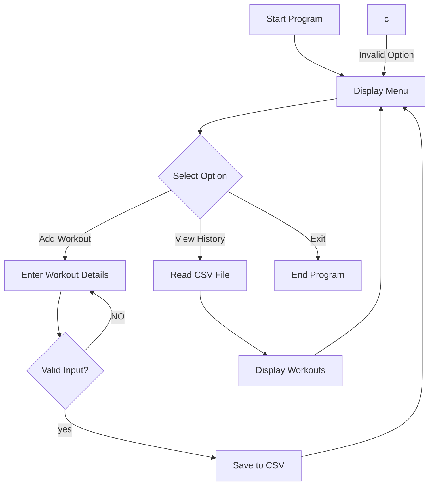

# Engineering Design Document


## Overview
The Workout Tracker App will allow users to 
record and view their workouts through a 
terminal-based menu. Workout information will 
be saved to a CSV file for future use.

## System Diagrams



## Technical Details


### Inputs

The user will enter information through
the terminal using the input function.

- Menu choice: string
- Exercise name: string
- Sets: interger
- Repetitions: interger
- Weight in pounds: float
- Workout date: automatically generated string:
#### Handling bad inputs

The program will use try and except statements
to handle invalid numbers. Sets and repetitons 
must be greater than zero. Weight cannot be 
negative. Exercise names cannot be empty.

Invalid inputs will display an error message
and allow the user to try again.

### Logicing

A while loop will keep the program running
until the user chooses to exit.

If, elif, and else statements will handle
menu selections. A for loop will display saved workout records from the CSV file.

If no workout file exists, the program will 
display a message instead of crashing
### Functions

- display_menu(): Displays menu options.
- add_workout(): Collections and validates inputs.
- save_workout(): Saves workout data to CSV.
- view_workout(): Displays saved workouts.
- main(): Controls the program

``` python
def main():
    while true:
        display_menu()
        choice = input('Select an option: ")

        if choice == "1":
            workout = add_workout()
            save_workout(workout)
        elif choice == "2":
            view_workouts()
        elif choice =="3":
            break
        else:
            print("Invalid option")

main()
```

### Libraries

- csv: Saves and reads workout records.
- datetime: Automatically records workout dates.
- unittest: Tests are program functionality.

These libraries are included with Python.

### Output

The program will display a menu, cofirmation
messages, error messages, and workout history.

Example output:

'''text
Welcome to Workout Tracker!

1. Add Workout
2. 2. View Workout History
3. Exit

Select an option 1 

Exercise: Bench Press
Sets: 3
Repetitions: 10
Weight (1Lbs): 135

Workout saved successfully!

## Testing Plan
-Verify valid workouts are saved correctly.
-Verify negative weights are rejected.
-Verify invalid menu options are handled.
-Verify empty exercise names are rejected.
-Verify workout history remains available
after restarting the program.

```

```
